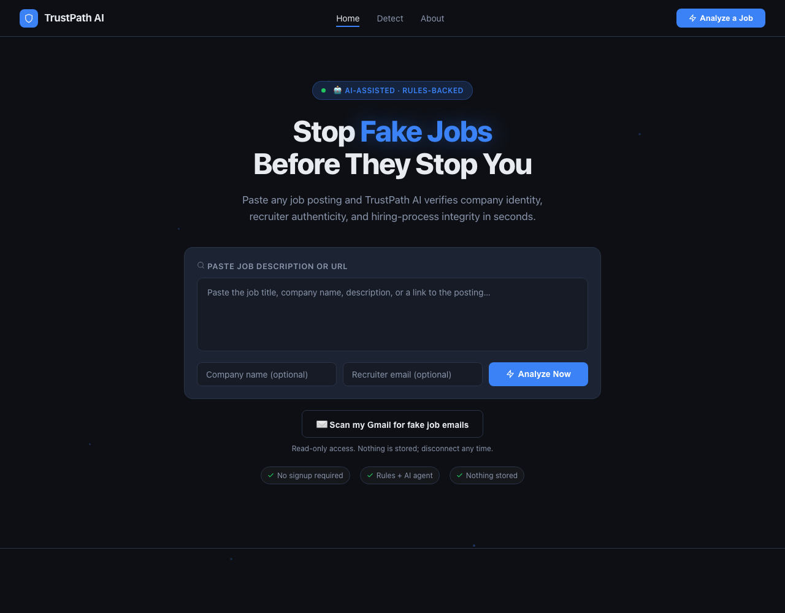

# TrustPath AI



Job fraud detection for job seekers. Paste a job posting and get a **Real / Suspicious / Fake** verdict, a confidence score, the signals behind it, and concrete next steps.

> **Status: early prototype.** The UI is a clickable demo with a mock keyword-based verdict. The backend is an API scaffold with no detection logic yet. See [Status and roadmap](#status-and-roadmap).

## Why

Roughly 1 in 7 online job postings is fraudulent (figure from the product copy; source not yet cited). Victims lose money (training fees, equipment deposits, overpayment cheques) and identity data (Aadhaar/PAN/SSN). Job platforms moderate their own listings, but scams migrate to WhatsApp, Telegram and personal email, and impersonate real companies, so the candidate is the last line of defence.

## Key idea: verify five things independently

A real company can have a fake posting that impersonates it, so checking the company alone is not enough. TrustPath scores five dimensions separately:

| # | Check | What it looks at |
|---|-------|------------------|
| 1 | Company identity | Domain intelligence, business registration, official website corroboration |
| 2 | Job posting integrity | Unrealistic salary, vague duties, urgency, payment requests disguised as onboarding |
| 3 | Recruiter verification | Recruiter vs. LinkedIn, company directories, official career-page listings |
| 4 | Communication channel | Off-platform chats, Gmail/Yahoo contacts, WhatsApp-only hiring, suspicious links |
| 5 | Hiring process | Upfront fees, equipment deposits, overpayment, early requests for sensitive documents |

## Fraud patterns addressed

| ID | Pattern | Planned detection |
|----|---------|-------------------|
| PS-01 | Fake company creation | Existence verification, domain intelligence, independent source corroboration |
| PS-02 | Genuine company impersonation | Compare official domains, recruiter identity, contacts and career-page listings |
| PS-03 | Lookalike domains (`careers-stripe.com`) | Domain similarity scoring, WHOIS age, SSL validation, typosquatting detection |
| PS-04 | Payment and deposit scams | NLP scan for payment language and urgency triggers |
| PS-05 | Off-platform communication | Channel analysis, cross-platform recruiter matching |
| PS-06 | Overpayment and data theft | Hiring-sequence analysis, sensitive-data request detection |

## Status and roadmap

| Area | State |
|------|-------|
| React UI (home, detect, result, Gmail inbox, about) | Working, wired to the API |
| `POST /api/v1/analyze` | Working: rules engine plus domain check (DNS and registration age via RDAP) |
| AI agent (OpenRouter tool calling: `check_domain`, `fetch_page`) | Working when `OPENROUTER_API_KEY` is set; falls back to rules only |
| Gmail scan (read-only OAuth) | Working when Google OAuth credentials are set; see below |
| Business registry / LinkedIn verification | Not implemented |
| Evaluation set and accuracy figure | Not built. **No accuracy is claimed.** |
| Persistence, auth, rate limiting | Not started (stateless by design) |

Next steps: labelled evaluation set, registry checks, rate limiting, per-user Gmail sessions backed by a store.

## Features

- **Analyze a posting:** verdict, trust score, five checks, signals, the agent's investigation trail, next steps, and a drafted message to verify the recruiter.
- **Gmail scan:** one click on the home page. Connect Gmail (read-only), and TrustPath lists job-related emails from the last 30 days (including Spam) ranked by risk, using rules and domain age. Click *Investigate* to run the full agent on any email. Tokens are kept in memory only and no mailbox content is stored; *Disconnect* ends the session.

## Architecture

```
frontend/ (React + Vite) ──/api proxy──> backend/ (FastAPI)
                                           app/api/routes/   analyze, gmail, health
                                           app/services/     rules, tools, openrouter (agent), analyzer, gmail
                                           app/schemas/      Pydantic models
                                           app/core/config.py env-driven settings
                                           tests/            pytest, runs offline
```

## Getting started

```bash
cd backend
python3 -m venv .venv && .venv/bin/pip install -r requirements.txt
cp .env.example .env              # see Configuration
.venv/bin/uvicorn app.main:app    # http://localhost:8000/docs
.venv/bin/pytest

cd ../frontend && npm install && npm run dev   # http://localhost:5173, proxies /api to :8000
```

### API

| Method | Path | Notes |
|--------|------|-------|
| GET | `/api/v1/health` | Status, version, environment |
| POST | `/api/v1/analyze` | Full analysis of one posting (agent if a key is set) |
| GET | `/api/v1/gmail/auth-url` | Starts Google OAuth; 503 if not configured |
| GET | `/api/v1/gmail/callback` | OAuth redirect target |
| POST | `/api/v1/gmail/scan` | Triage recent job emails, riskiest first (no LLM) |
| POST | `/api/v1/gmail/disconnect` | Ends the Gmail session |

### Configuration (`backend/.env`)

| Variable | Purpose |
|----------|---------|
| `OPENROUTER_API_KEY` | Enables the AI agent. Get one at https://openrouter.ai/keys. Empty = rules only |
| `OPENROUTER_MODEL` | Default `openai/gpt-4o-mini` |
| `GOOGLE_CLIENT_ID`, `GOOGLE_CLIENT_SECRET` | Enables Gmail scan. In Google Cloud Console: enable the Gmail API, create an OAuth client (Web application), add redirect URI `http://localhost:8000/api/v1/gmail/callback`, and add your Google account as a test user |
| `FRONTEND_URL` | Where to return after Google sign-in (default `http://localhost:5173`) |

## Limitations and risks

- A verdict is a risk signal, not proof. False positives can unfairly flag real employers; false negatives can give false comfort. The UI carries a disclaimer and the product should keep it.
- Checks that call third parties (WHOIS, registries, LinkedIn) have cost, rate limit and terms-of-service implications; LinkedIn in particular restricts scraping.
- Pasted job text and recruiter emails are personal data. Define retention and logging policy before any hosted deployment.
